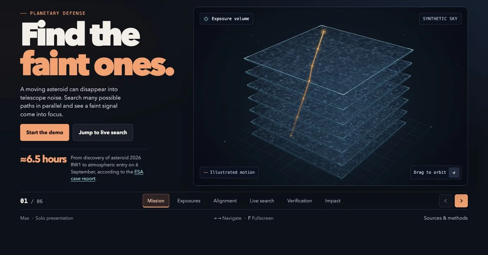
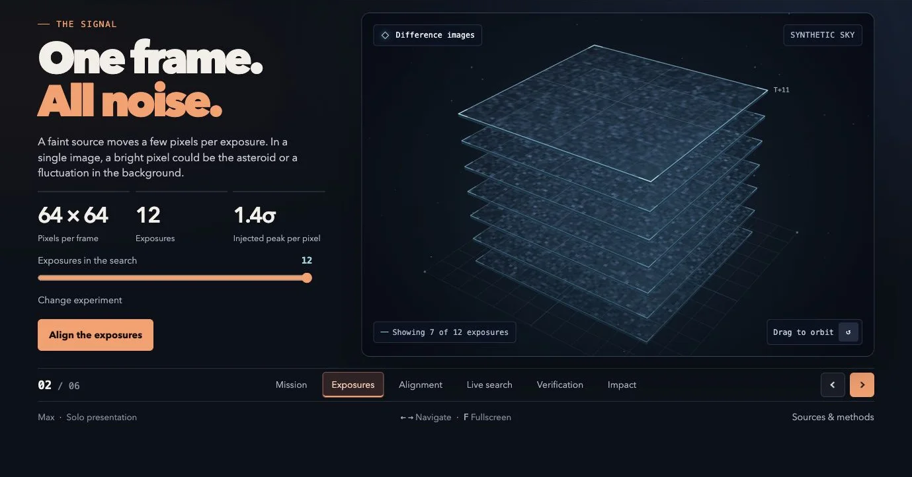
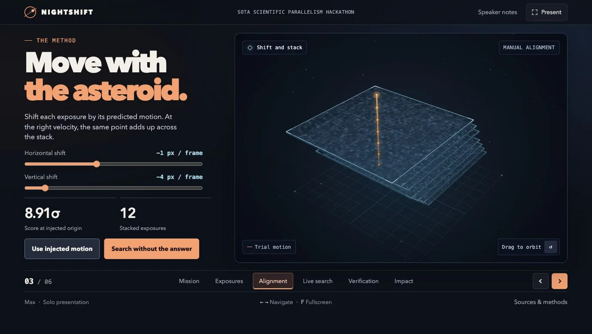
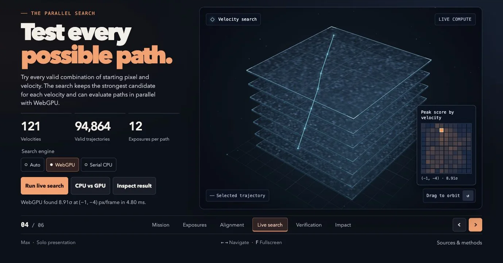
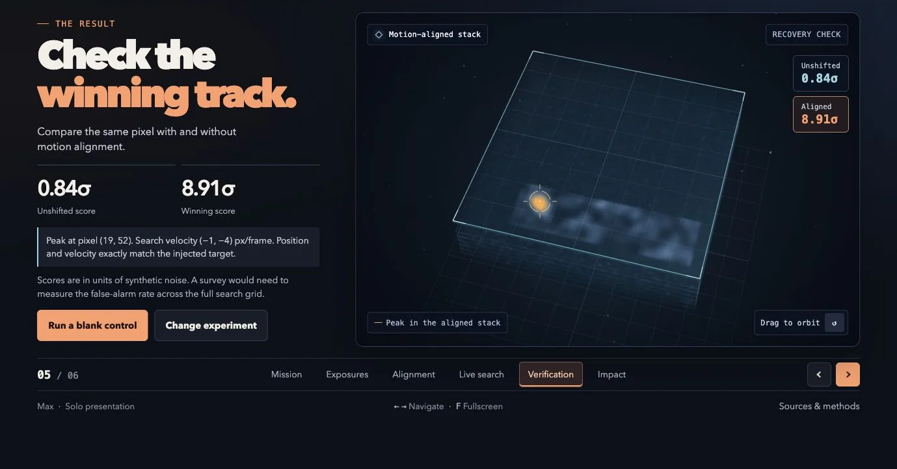
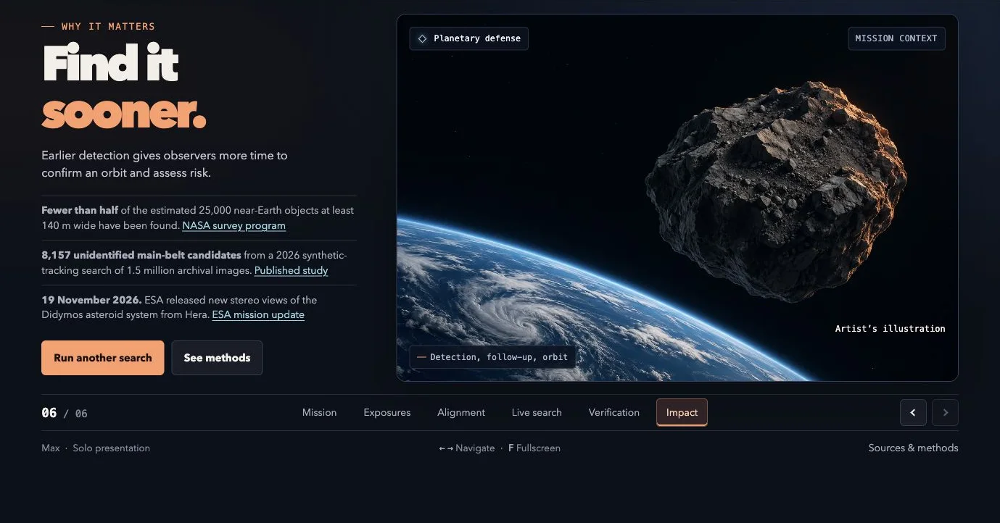

# Nightshift

**Find a moving asteroid in telescope noise.** Nightshift is a browser-based experiment and six-screen presentation built for Max’s solo SoTA Scientific Parallelism Hackathon entry. Rotate a 3D stack of simulated exposures, align it by hand, then run a blind search over possible asteroid paths on WebGPU or a serial CPU. [Hackathon brief](https://luma.com/scientific-parallelism)

[Open the live presentation](https://nightshift-orpin-six.vercel.app)

## What the demo finds

The default experiment (seed **27**, **12** exposures, **1.4σ** injected peak per pixel) tests **94,864** valid trajectories across **121** velocities.

| Check | Default result |
| --- | --- |
| Unshifted score at the injected origin | **0.84σ** |
| Winning motion-aligned score at that same pixel | **8.91σ** |
| Recovered origin and motion | **(19, 52)** and **(−1, −4) px/frame**, matching the injection |
| Peak in the same noise with the source removed | **4.10σ** |

The scores are in units of the simulated noise. The blank run shows how searching many paths can surface a strong-looking peak in a single noise-only scene. A real survey would need calibrated imagery, a measured false-alarm rate across the search, and independent follow-up.

## Run it

The demo runs entirely in the browser. Serve the static app with Python 3 from the repository root and open [http://localhost:8765](http://localhost:8765).

```sh
python3 -m http.server 8765 --directory dist
```

Use **←** and **→** to navigate, **F** for fullscreen, and **Speaker notes** for a 2½-minute walkthrough. For a quick run, choose **Jump to live search**, run the default experiment, then open **Verification** to compare the result with ground truth. **Auto** tries WebGPU and falls back to a CPU Web Worker. **Serial CPU** selects that worker directly.

For an offline presentation, generate the self-contained HTML file from the same source. Open the resulting `Nightshift-offline.html` in your browser. Use **Serial CPU** if the browser lacks WebGPU.

```sh
python3 scripts/build_offline.py
```

The Vercel Git integration deploys pushes to `main` to production.

## Interactive walkthrough

### 1. Mission

Asteroid 2026 RW1 was discovered only hours before atmospheric entry. Finding fainter moving objects could give observers more time to follow up. [ESA case report](https://neo.ssa.esa.int/past-impactors/2026rw1)



### 2. Exposures

Orbit the noisy 64 × 64-pixel difference images to see how the data is organized across time. Change the exposure count, seed, or injected brightness to explore a new experiment.



### 3. Alignment

Adjust horizontal and vertical motion to shift the frames into a common reference frame. Use the injected motion to see the signal add coherently at its origin.



### 4. Live search

Run a blind search over the full velocity grid. The heatmap shows the strongest peak for each velocity and lets you inspect alternatives to the winning path.



### 5. Verification

Compare the recovered origin and velocity with the known injection, and compare aligned and unshifted scores at the same pixel. Run the blank-sky control to see the strongest peak produced by noise alone.



### 6. Impact

Earlier detection gives observers time to confirm an orbit and assess risk. The closing page places the experiment in the context of near-Earth-object surveys and ESA’s November 2026 stereoscopic imagery of the Didymos system. [ESA Hera update](https://www.esa.int/articles/about-us/directorates/operations/space-safety/hera/sir-brian-may-adds-new-dimension-to-hera-asteroid)



## How the search works

1. Generate noisy exposures with an optional Gaussian source moving at a constant integer velocity.
2. Apply a separable, noise-normalized Gaussian matched filter to each frame.
3. Try all velocities from −5 to +5 pixels per exposure on both axes. For each valid starting pixel, sum the filtered samples along the path and divide by the square root of the number of exposures.
4. Keep the highest-scoring starting pixel per velocity and select the overall peak. The CPU enumerates paths serially. The WGSL kernel scores them in parallel and reduces each workgroup before the browser reads back the peaks.

The **CPU vs GPU** control runs a warm-up and reports the median of three trials per engine. Both engines use the same prefiltered data. CPU time includes worker dispatch and result transfer. GPU time includes buffer allocation, upload, dispatch, readback, and host reduction. The results describe the browser and device running the comparison.

The app uses static HTML, CSS, JavaScript modules, and Canvas. The [search engine](dist/compute.mjs), [worker](dist/search-worker.mjs), and [3D stage](dist/stage.mjs) are in `dist/`. The method builds on synthetic tracking demonstrated on Palomar telescope observations. [Zhai et al., 2014](https://arxiv.org/abs/1403.4353)
